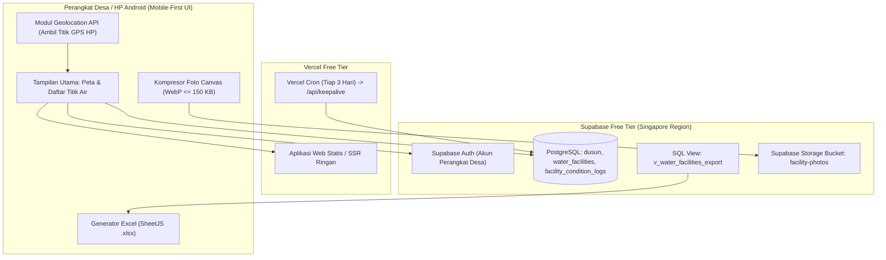
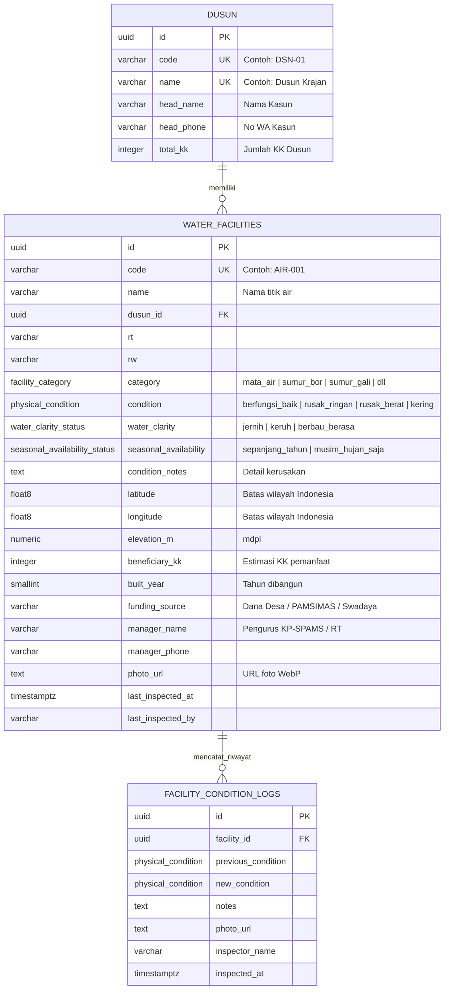

# Rancangan Arsitektur & Database: Sistem Inventarisasi Fasilitas dan Sumber Air Desa (SI-AIR DESA)

## 1. Ringkasan Eksekutif & Tujuan Proker KKN
Aplikasi web ringan, *mobile-first*, dan bebas biaya langganan bulanan untuk membantu perangkat desa serta pengurus KP-SPAMS melakukan pemetaan, pencatatan kondisi fisik, dan pelaporan fasilitas air bersih desa (RPJMDes / SDGs Desa Goal 6).

---

## 2. Tech Stack & Strategi "Gratis Selamanya" (Zero-Cost Forever)

| Lapisan | Teknologi | Alasan Teknis & Batas Kuota Gratis |
| :--- | :--- | :--- |
| **Frontend & Hosting** | **Next.js (App Router) / Vite React + Tailwind CSS** di **Vercel Hobby** | *Bundle size* kecil, *mobile-first*, bandwidth gratis 100 GB/bulan, HTTPS otomatis. |
| **Database & Auth** | **Supabase (PostgreSQL 15 + Auth)** | 500 MB database Postgres (~250.000 baris data titik air), 50.000 MAU gratis. |
| **Penyimpanan Foto** | **Supabase Storage + Kompresi WebP Client-Side** | Kuota gratis 1 GB. Kompresi otomatis di browser HP ke WebP (<150 KB/foto) sebelum diunggah -> muat >6.000 foto lapangan. |
| **Peta Interaktif** | **Leaflet.js + OpenStreetMap / Esri World Imagery** | 100% gratis selamanya tanpa API Key berbayar atau kartu kredit (berbeda dengan Google Maps API). |
| **Export Laporan** | **SheetJS (`xlsx`) Client-Side Dynamic Import** | Mengolah data langsung di perangkat menjadi file `.xlsx` dua *sheet* (Ringkasan Dusun & Daftar Titik Air) tanpa membebani limit fungsi server. |
| **Anti-Pause Guard** | **Vercel Cron Job (`/api/keepalive`)** | Supabase Free Tier otomatis *pause* jika 7 hari tanpa trafik. Cron berjalan tiap 3 hari (`0 0 */3 * *`) melakukan `SELECT 1` agar aplikasi desa aktif selamanya pasca-KKN. |

---

## 3. Arsitektur Sistem & Alur Data

---

## 4. Desain Fitur Utama & UX Perangkat Desa

1. **Beranda Ringkasan Cepat (Dashboard Kartu Status)**:
   - Menampilkan 4 indikator besar dengan kode warna kontras tinggi (mudah dibaca di bawah sinar matahari):
     - **Total Titik Air**
     - **Berfungsi Baik (Hijau)**
     - **Rusak Ringan (Kuning/Oranye)** — prioritas pemeliharaan rutin
     - **Rusak Berat / Kering (Merah/Abu-abu)** — prioritas anggaran Dana Desa
2. **Tab Dual-View (Peta Desa <-> Daftar Tabel/Kartu)**:
   - **Mode Peta**: Marker berwarna sesuai kondisi fisik (`Hijau`, `Kuning`, `Merah`, `Abu-abu`). Klik marker menampilkan foto, nama fasilitas, dusun, kondisi, dan tombol **"Buka Rute di Google Maps"**.
   - **Mode Daftar**: Dilengkapi filter instan per **Dusun**, **Jenis Fasilitas**, dan **Kondisi Fisik** + kolom pencarian nama/kode.
3. **Form Input & Update Kondisi Lapangan (1 Halaman Sederhana)**:
   - Tombol besar **"📍 Ambil Koordinat Lokasi Saya Sekarang"** menggunakan GPS HP (`enableHighAccuracy: true`) lengkap dengan indikator akurasi meter.
   - Pilihan kondisi fisik menggunakan **Tombol Radio Besar Berwarna** (bukan *dropdown* kecil yang sulit ditekan).
   - Input kamera langsung dari HP (`capture="environment"`) yang otomatis dikompresi sebelum dikirim ke server.
4. **Tombol "Unduh Laporan Excel (.xlsx)"**:
   - Menghasilkan file siap cetak untuk lampiran LPJ KKN dan arsip Sekretaris Desa, berisi:
     - **Sheet 1 (Rekapitulasi per Dusun)**: Jumlah titik air menurut jenis, kondisi, dan total KK pemanfaat.
     - **Sheet 2 (Data Lengkap Titik Air)**: Seluruh kolom dari view `v_water_facilities_export`.

---

## 5. Arsitektur Database (Entity-Relationship Diagram)

Skema lengkap tersedia di [20261110000001_init_water_inventory.sql](file:///C:/Users/upgra/.gemini/antigravity/scratch/inventaris-air-desa/supabase/migrations/20261110000001_init_water_inventory.sql).

---

## 6. Keamanan (Row-Level Security), Offline Queue & Mitigasi Risiko

- **Antrean Offline-First & Deteksi Konflik (`src/services/offlineQueue.ts`)**:
  - Operasi tulis/hapus milik Pemdes saat offline atau gangguan jaringan disimpan ke outbox `localStorage` (`si_air_kalikayen_offline_queue_v1`) lengkap dengan validasi kuota penyimpanan (`Memori offline perangkat penuh`), pemetaan `localId -> serverId`, penghapusan operasi turunan apabila `create` induk ditolak validasi server, penguncian antrean saat sesi auth kedaluwarsa (`abortedByAuth`), serta banner permanen `Konflik Sinkronisasi Offline` yang dapat ditinjau/ditutup petugas.
- **Pemisahan Akses Warga & Perangkat Desa (`Supabase Auth + Edge Gateway`)**:
  - **Database Lockdown (`anon` Revoked)**: Role publik `anon` dicabut total (`REVOKE ALL`) dari tabel `dusun`, `water_facilities`, `facility_condition_logs`, dan view `v_water_facilities_export`, disertai penguncian policy lama dan `security_invoker = true`.
  - **Portal Publik Tersensor (`supabase/functions/airlog-public-portal/index.ts`)**: Warga tanpa login membaca peta/rekap dengan kolom `head_phone` dan `manager_phone` disensor menjadi `null`, serta mengirimkan laporan kondisi QR lewat endpoint `POST ?action=report` bervalidasi skema, batas ukuran foto, honeypot, dan jeda anti-spam 60 detik.
  - **Otorisasi Pemdes & Admin (`src/services/authService.ts`)**: Login `Supabase Auth` memeriksa peran dari `app_metadata.role` (`pemdes` vs `admin`). Semua operasi kelola data induk (`INSERT`/`UPDATE`) wajib terautentikasi, sedangkan **Hapus Titik Air** dan **Unggah/Kelola APK (`storage.objects` bucket `apk-releases`)** khusus role `admin`.
  - Lihat skrip migrasi lengkap: [20261126000001_lockdown_auth_and_storage.sql](./supabase/migrations/20261126000001_lockdown_auth_and_storage.sql).
- **Trigger Audit Otomatis**:
  - Setiap perubahan pada kolom `condition` atau `condition_notes` di tabel `water_facilities` otomatis menyisipkan baris riwayat ke `facility_condition_logs` melalui trigger PostgreSQL `trg_log_facility_condition` (dengan `search_path = public`).
- **Rollback Plan**:
  - Seluruh migrasi dibungkus transaksi atomik (`BEGIN ... COMMIT`) dan menggunakan klausa idempoten.
