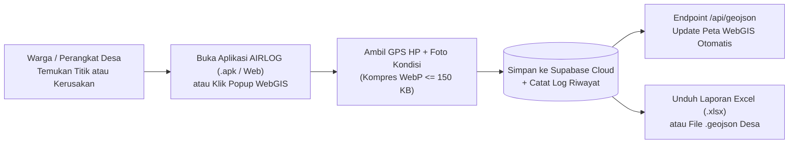

# Product Requirements Document (PRD)
## AIRLOG — Aplikasi Inventarisasi & Pelaporan Kondisi Sarana Air Bersih Desa Kalikayen

| Atribut Dokumen | Keterangan |
| :--- | :--- |
| **Nama Produk** | AIRLOG Kalikayen (*Portal Informasi Air Desa & Pelaporan Partisipatif*) |
| **ID Paket Android** | `id.kalikayen.airlog` (`AIRLOG-Desa-Kalikayen.apk`) |
| **Versi Dokumen** | v1.0 |
| **Lokasi Sasaran** | Desa Kalikayen, Kecamatan Ungaran Timur, Kabupaten Semarang |
| **Wilayah Cakupan** | 5 Dusun: Kalikayen, Lengkongsari, Watukebo, Kebuntaman, dan Mulyosari |
| **Tautan Web & Cloud** | Web/PWA: `https://si-air-kalikayen.vercel.app` • API GeoJSON: `/api/geojson` |
| **Repositori Kode** | `https://github.com/zephyrusrothstaylor-maker/airlog-desa-kalikayen` |
| **Penyusun** | Tim Pengembang AIRLOG — KKN-T Desa Kalikayen Kelompok 4 |
| **Tanggal** | 17 November 2026 |

---

## 1. Latar Belakang & Permasalahan

Desa Kalikayen memiliki banyak titik sarana air bersih di lima dusun, seperti mata air alami, sumur bor, sumur gali komunal, bak PAMSIMAS, kran umum, sampai jalur pipa distribusi. Data lokasi dan kondisi fisiknya masih terpisah-pisah. Akibatnya, perangkat desa kesulitan memetakan titik mana yang paling mendesak diperbaiki saat musim kemarau tiba atau ketika terjadi kebocoran pipa.

Aplikasi **AIRLOG** hadir supaya pendataan tidak berhenti sebagai arsip sekali survei saja. Pengurus KP-SPAMS, ketua RT/RW, mahasiswa KKN, maupun warga dapat mengirim pembaruan kondisi langsung lewat kamera HP dan GPS, lalu hasilnya otomatis tersimpan di cloud serta terhubung ke **WebGIS Air Desa Kalikayen**.

---

## 2. Tujuan Produk

1. Mendata seluruh titik sumber dan fasilitas air bersih Desa Kalikayen berikut koordinat GPS (`latitude`, `longitude`, `elevation_m`), jenis sarana, jumlah KK pemanfaat, sumber dana, serta kontak pengelola.
2. Menyediakan formulir pelaporan kerusakan partisipatif berbasiskan foto lapangan dan geotagging langsung dari ponsel.
3. Menghubungkan basis data laporan ke **WebGIS Air Desa Kalikayen** memakai format standar **GeoJSON (WGS84 / EPSG:4326)** lewat *endpoint* `/api/geojson`.
4. Memungkinkan perangkat desa mengunduh laporan rekap dua lembar dalam format Microsoft Excel (`.xlsx`) kapan saja.
5. Menjaga aplikasi tetap gratis pasca-KKN melalui Vercel Hobby, Supabase Free Tier, peta OpenStreetMap/Esri, serta paket Android Capacitor (`AIRLOG-Desa-Kalikayen.apk`).

---

## 3. Target Pengguna

| Peran | Kebutuhan Utama | Modul yang Dipakai |
| :--- | :--- | :--- |
| **Perangkat Desa & Kepala Dusun** | Memantau status sarana air di tiap dusun untuk bahan rapat desa dan prioritas perbaikan. | Dashboard ikhtisar, Rekap Dusun, Ekspor Excel (`.xlsx`). |
| **Pengurus KP-SPAMS / PAMSIMAS** | Menambah titik survei baru dengan GPS HP dan memperbarui riwayat perbaikan sarana. | Modal Tambah Titik Air, Modal Cek Fisik, Navigasi Google Maps. |
| **Warga & Ketua RT/RW** | Melaporkan gangguan aliran, air keruh, atau kerusakan fisik tanpa langkah yang rumit. | Aplikasi Android `.apk` / PWA, tombol cepat **Cek Fisik**, QR WebGIS (`?action=lapor`). |
| **Admin WebGIS Desa** | Menarik layer titik air terbaru ke peta Leaflet maupun aplikasi QGIS. | Ekspor `.geojson`, API `/api/geojson`, cuplikan kode Leaflet. |

---

## 4. Ruang Lingkup Fitur

| Kode | Fitur / Modul | Rincian Kebutuhan Fungsional | Berkas Terkait |
| :--- | :--- | :--- | :--- |
| **FR-01** | **Dashboard Ringkasan** | Menampilkan 4 kartu kondisi (*Berfungsi Baik*, *Rusak Ringan*, *Rusak Berat*, *Kering Musiman*), total KK terlayani, 6 menu cepat, serta daftar *Titik Air Perlu Perhatian*. Data fasilitas awal diset **0 titik** (bersih dari dummy) dengan 5 dusun resmi sudah terisi. | `src/components/DashboardView.tsx` |
| **FR-02** | **Tambah Titik & GPS** | Mengambil koordinat `latitude`, `longitude`, dan `elevation_m` otomatis lewat `Geolocation API` (`enableHighAccuracy: true`) atau input manual, kode titik otomatis (`AIR-001`), serta 8 kategori sarana dan 5 dusun resmi. | `src/components/AddFacilityModal.tsx` |
| **FR-03** | **Cek Fisik & Kompresi Foto** | Input status fisik (4 status), kejernihan air (3 status), ketersediaan musiman (2 status), catatan kerusakan, serta kompresi foto kamera HP otomatis ke **WebP** (`<= 1280 px`, target `<= 150 KB`) dengan riwayat tercatat via *trigger* `trg_log_facility_condition`. | `src/components/ConditionModal.tsx` |
| **FR-04** | **Peta Air Interaktif** | Peta Leaflet dengan dua *basemap* gratis (**OpenStreetMap** dan **Esri World Imagery**), penanda warna sesuai kondisi, kartu info lokasi, serta tautan rute Google Maps. | `src/components/MapExplorerView.tsx` |
| **FR-05** | **Daftar, Filter, & Rekap Dusun** | Pencarian nama/kode/lokasi dan filter per Dusun, Jenis Sumber, serta Kondisi Fisik; dilengkapi tab Rekap Dusun dan ekspor Excel `.xlsx` 2 *sheet* via SheetJS. Hapus titik air dibatasi khusus role `admin`. | `src/components/FacilityListView.tsx` |
| **FR-06** | **Integrasi WebGIS & `.apk`** | Ekspor berkas `.geojson` (WGS84 / `CRS84`), *endpoint* live `/api/geojson` ber-CORS `*` (sensor kontak publik), *deep-link* `/?action=lapor&code=...`, serta build native Android `id.kalikayen.airlog` (`AIRLOG-Desa-Kalikayen.apk`, v1.5) via Capacitor. | `src/components/WebGisIntegrationModal.tsx` |
| **FR-07** | **Autentikasi Pemdes & Gateway Warga** | Warga melihat peta/rekap & mengirim laporan QR tanpa login lewat Supabase Edge Function `airlog-public-portal` (kontak WA disensor & jeda anti-spam 60 detik); Perangkat Desa wajib login `Supabase Auth` untuk kelola data induk (`authenticated`) serta sinkronisasi antrean offline + peninjauan konflik (`offlineQueue`). | `src/services/authService.ts`, `supabase/functions/airlog-public-portal/index.ts` |

---

## 5. Arsitektur Teknis & Skema Basis Data

| Lapisan | Teknologi yang Dipakai | Detail Penting |
| :--- | :--- | :--- |
| **Antarmuka Web** | React 18, TypeScript 5.7, Vite 6, Tailwind CSS 3 | *Mobile-first*, palet kontras tinggi untuk pemakaian luar ruangan. |
| **Peta & Spasial** | Leaflet 1.9 + OpenStreetMap + Esri Satellite | Gratis tanpa API key berbayar. |
| **Basis Data Cloud** | Supabase PostgreSQL 15+ (`ap-southeast-1`) | Tabel `dusun`, `water_facilities`, `facility_condition_logs`, view `v_water_facilities_export`, RLS aktif. |
| **Validasi Koordinat** | Constraint SQL wilayah Indonesia | `latitude` antara `-11.5` s.d. `6.5`, `longitude` antara `94.5` s.d. `141.5`. |
| **Keep-Alive Hosting** | Vercel Hobby + Vercel Cron (`0 0 */3 * *`) | Memanggil `/api/keepalive` setiap 3 hari agar Supabase Free Tier tidak otomatis *pause*. |
| **Mobile Native** | Capacitor 8 + Gradle 8.14.3 + Android SDK 36 | Izin `ACCESS_FINE_LOCATION`, `ACCESS_COARSE_LOCATION`, dan fitur GPS perangkat. |

*(Rincian skema SQL dan diagram relasi tabel tersedia di [ARCHITECTURE.md](./ARCHITECTURE.md) serta [20261110000001_init_water_inventory.sql](./supabase/migrations/20261110000001_init_water_inventory.sql)).*

---

## 6. Kebutuhan Non-Fungsional & Ketahanan Lapangan

- **Navigasi Satu Tangan:** Bilah bawah 5 menu (*Beranda*, *Peta Air*, *Cek Fisik*, *Daftar*, *Rekap*) memudahkan survei sambil memegang ponsel.
- **Ketahanan Offline Lapangan:** Saat koneksi ke Supabase terputus di area blank spot, `offlineQueue.ts` menjaga antrean mutasi lokal secara atomik, meng-cascade konflik pembuatan induk, membekukan antrean saat sesi kedaluwarsa, serta menampilkan banner konflik permanen yang dapat ditinjau petugas.
- **Privasi & Keamanan Data Desa:** Role `anon` dicabut penuh dari tabel dan view PostgreSQL (`REVOKE ALL`) serta bucket APK `apk-releases`; akses publik berjalan aman via Edge Gateway tersensor.
- **Uji Coba & Panduan:** Panduan operasional perangkat desa tersedia di [PANDUAN_SERAH_TERIMA_PEMDES.md](./PANDUAN_SERAH_TERIMA_PEMDES.md).

---

## 7. Alur Penggunaan Lapangan

---

## 8. Kriteria Penerimaan (Acceptance Checklist)

1. Data awal tampil **0 titik air** bersama 5 dusun resmi Desa Kalikayen (`Kalikayen`, `Lengkongsari`, `Watukebo`, `Kebuntaman`, `Mulyosari`), bersih dari data dummy.
2. Tambah titik GPS berhasil masuk ke Supabase Cloud.
3. Kompresi foto WebP menjaga ukuran berkas di bawah `150 KB` dengan batas dimensi maksimal `1280 px` sebelum diunggah dari kamera ponsel lapangan.
4. Ekspor `.xlsx` (2 *sheet*) dan `.geojson` (WGS84) valid dibuka di Excel, Leaflet, dan QGIS.
5. Endpoint `/api/geojson` merespons normal dan `AIRLOG-Desa-Kalikayen.apk` siap pakai di HP Android.
